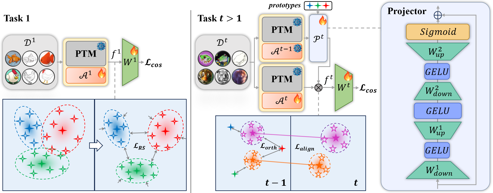

# Representation-Steered Incremental Adapter-Tuning for Class-Incremental Learning with Pre-Trained Models

  

This repository serves as the official implementation corresponding to the paper titled "Representation-Steered Incremental Adapter-Tuning for Class-Incremental Learning with Pre-Trained Models". 


## Installation
### Requirements
Ubuntu 20.04 LTS

Python 3.10

CUDA 11.8

Detailed package information and corresponding versions are available in the requirements.txt file.

### Data preparation

The overall directory structure should be:
```
RSIAT/
├──data/
├──datasets/
│   ├──cifar-100-python/
│   ├──cub/
│   ├──imagenet-a/
│   ├──imagenet-r/
│   ├──omnibenchmark/
│   ├──vtab/
│   ......
├──.......
```

## Training and evaluation

The training and evaluation instructions for each dataset are in the "./args.sh" file. Each dataset can be calculated separately, and the results are stored in the "./logs" folder.

### Checkpoint and resume

Each experiment configuration saves a checkpoint after every completed incremental task. Checkpoints are isolated by seed and stored at:

```
ckpt/<prefix>/<dataset>/<init_cls>_<increment>/seed_<seed>/task_<N>.pkl
```

The default configurations keep only the most recent checkpoint to reduce disk use. To resume a stopped run, set the following in the same JSON configuration and run the original command again:

```json
{
  "resume": true
}
```

Optionally set `"resume_path"` to a specific `task_N.pkl`, `"keep_last_checkpoint": false` to retain every task checkpoint, or `"max_tasks_per_run"` to stop cleanly after a fixed number of tasks. Resume requires the same dataset, seed, class order, initial/incremental class split, model, and backbone. Standard checkpoints are task-boundary snapshots. The supplied configurations retain full covariance (`"compact_diagonal_checkpoint": false`) for an exact task-boundary resume; enable the compact diagonal form only when Drive space matters, since it drops covariance cross-terms used by classifier alignment.

### Shared Adapter + M-only KeepLoRA

The opt-in `keeplora_m_only` mode is configured by
`shared_adapter_update_mode`. Task 0 uses the original RSIAT training path;
the AdamW and SGD incremental runs both load the same Task-0 checkpoint. From
Task 1 onward, KeepLoRA factors are attached only to each Shared Adapter's
down/up Linear weights. The original weights and A factors stay frozen while B
is optimized. `incremental_optimizer` selects the optimizer family for every
active trainable module in the incremental main-training stage from Task 1
onward. CA remains the RSIAT baseline SGD stage for both options in this first
experiment. Per-module learning rates and weight decay may differ; SGD momentum
or AdamW betas/epsilon are shared by the selected family. Task 0 still uses
the baseline `optimizer` setting. Thus, the AdamW/SGD comparison is not an
adapter-only optimizer comparison.

The M-only mode uses the original RSIAT RAE decoder initialization order.
Existing modes retain their seeded initialization order.

The supplied M-only configs set down/up rank caps to 32 and use fixed effective
scaling 0.0625. Each module/task's realized rank may be lower than its cap,
bounded by the remaining feature dimension and numerical rank of its projected
initialization gradient. Initialization averages the RSIAT main-training loss
gradient over a separate current-task loader and uses the same randomized
low-rank SVD and factorized forward as KeepLoRA on attention/MLP. The SVD runs
in the orthogonal complement of the stored feature basis. Basis collection
uses all input tokens from current-task training examples with evaluation
transforms. The feature threshold applies to the combined energy captured by
existing and newly added directions. Both optimizer variants use the same caps
and factorization rule. Realized ranks and numeric feature bases are logged and can
differ after the model trajectories diverge. Task 1 starts from the same
Task-0 model and the same M0 checksum. The initial Task-1 A/B factors are also
hashed and logged in both runs. Subsequent tasks do not force the two runs to
share identical basis tensors after their model trajectories diverge.

Run the common Task-0 configuration once, then launch both incremental configs:
although the mode is enabled for post-training M0 collection, Task 0 itself
does not attach factors or change the RSIAT optimizer/training path. The
completed Task-0 checkpoint contains the shared Adapter checksum and M0 basis
checksum, which both optimizer branches validate and reuse.
Regenerate the common checkpoint if its M0 was built with the earlier 64-token
per-batch cap. Incremental runs with an explicit resume path require that
checkpoint or an existing snapshot of their own run.

```powershell
python main.py --config .\exps\exp1_h64_shared_adapter_task0.json
python main.py --config .\exps\exp1_h64_monly_keeplora_fulladamw_main.json
python main.py --config .\exps\exp1_h64_monly_keeplora_fullsgd_main.json
python main.py --config .\exps\exp1_h64_monly_keeplora_fulladamw_main_rank16.json
python main.py --config .\exps\exp1_h64_monly_keeplora_fullsgd_main_rank16.json
```

Both rank-16 configs reuse the common Task-0 checkpoint and differ from their
rank-32 counterparts only in the run prefix and down/up rank caps. All four
incremental runs measure semantic drift on the same deterministic test probes.
Task 0 contributes the first accuracy snapshot to the forgetting history.
Each incremental task writes `task_XX.json` and updates one row in
`semantic_drift/<prefix>/summary.csv`. Mean forgetting is the mean over old
tasks of their best previous Top-1 minus their current Top-1, in percentage
points. Reports include the number of old tasks with a recorded history.

These two M-only configs enable `save_mid_task_checkpoints`. They save the
model (including active A/B factors), frozen previous-task network, RAE,
optimizer/scheduler states, and RNG states after each incremental epoch.
Automatic resume prefers a newer mid-task checkpoint over an older completed
task checkpoint and resumes at the next epoch. `resume_latest` allows the
shared Task-0 checkpoint to be used on the first launch, then selects the
latest checkpoint in that incremental run directory on later launches.
Mid-task snapshots are removed after a task-boundary checkpoint is written.
New M-only task-boundary snapshots also store the RNG state. It is restored
before the next task starts, after rebuilding the model and classifier.
Keep the two optimizer runs in their separate configured prefixes; do not
share their incremental checkpoint directory.

### Efficient training

`eval_interval: 0` and `ca_eval_interval: 0` evaluate only the final epoch of each training stage. This avoids repeated full validation passes without changing gradients, optimizer steps, or the cosine scheduler. Set either value to a positive number when intermediate validation curves are needed. `num_workers`, `stats_num_workers`, `pin_memory`, and `persistent_workers` configure data loading; the provided values are suitable starting points for a GPU runtime.

### Semantic-shift diagnostics

After each incremental task, the existing RSIAT log records `feature_shift` and
`prototype_drift` diagnostics. `sample_drift_mean_norm` is the mean per-sample
feature displacement, while `sample_drift_norm_mean` is the norm of the mean
displacement vector. Prototype and SSC fields report the old-class prototype
shift before and after the existing semantic-shift compensation; they are
observational metrics only and do not affect training or compensation.

### Optional global SSCA decay

The default SSCA update remains unchanged for configurations without
`ssca_scale_mode`. To run the opt-in global decay ablation, set
`ssca_scale_mode` to `global_decay` and provide `ssca_global_gamma` in `[0, 1]`.
For incremental task index `t` (`_cur_task`), the full prototype displacement is
scaled by `gamma ** (t - 1)`: task 1 keeps the original update, task 2 uses
`gamma`, and task 5 uses `gamma ** 4`. A single scalar is applied to every old
class prototype in that task. `ssca: false` still disables prototype
compensation.

The KeepLoRA + AdamW experiment uses:

    python main.py --config ./exps/keeplora_adamw_ssca_global_g090.json
    python main.py --config ./exps/keeplora_adamw_mlp_ssca_global_g090.json
    python main.py --config ./exps/keeplora_adamw_ssca_age_g090.json
    python main.py --config ./exps/keeplora_adamw_mlp_ssca_age_g090.json

The first configuration applies KeepLoRA to attention Q/K/V/O; the second
applies it to the MLP fc1/fc2 projections. They share the same SSCA decay and
semantic-drift diagnostics but use separate output prefixes.
The original MLP baseline (`exps/keeplora_adamw_mlp.json`) also enables the
same diagnostics so its drift reports can be compared with the global- and
age-decay MLP runs.

### KeepLoRA AdamW without SSCA

These matched ablations disable only the prototype compensation step while
keeping the existing AdamW recipe, KeepLoRA placement, RSIAT losses, and CA:

    python main.py --config ./exps/keeplora_adamw_nossca.json
    python main.py --config ./exps/keeplora_adamw_mlp_nossca.json

Compare them respectively with `keeplora_adamw.json` (Q/K/V/O) and
`keeplora_adamw_mlp.json` (MLP). Each pair differs only in `ssca` and the run
prefix. The MLP pair keeps the same semantic-drift diagnostics enabled; the
Q/K/V/O pair retains its existing configuration without that observer.
Disabling SSCA does not disable RAE alignment/orthogonal losses, KeepLoRA
subspace updates, or classifier alignment (CA).

The age-aware configuration instead scales each old prototype using
`ssca_scale_mode: "age_decay"` and `ssca_age_gamma`. Its class-to-task mapping
uses the actual `task_sizes` recorded by the data manager, including an uneven
final task. This mode is independent of `global_decay`; do not combine their
factors in a single run.

### KeepLoRA AdamW with an SGD RAE

To keep AdamW for the KeepLoRA backbone and classifier while using the RSIAT
baseline's SGD momentum optimizer for the RAE, run either paired target recipe:

    python main.py --config ./exps/keeplora_adamw_sgd_rae.json
    python main.py --config ./exps/keeplora_adamw_mlp_sgd_rae.json

Both runs keep SSCA and CA enabled, use SGD momentum `0.9` for the incremental
RAE, and take its learning rate and weight decay from `ae_init_lr` and
`ae_weight_decay`. The backbone/classifier remain on the existing AdamW recipe.
The separate RAE optimizer uses the same per-epoch cosine schedule as the main
optimizer. Semantic-drift diagnostics are enabled for analysis only. These
isolated configs use fresh prefixes and do not resume existing checkpoints.

### KeepLoRA AdamW with SGD RAE and classifier

To keep AdamW for the KeepLoRA backbone while using separate SGD momentum
optimizers for the RAE and classifier, run:

    python main.py --config ./exps/keeplora_adamw_sgd_rae_sgd_classifier.json
    python main.py --config ./exps/keeplora_adamw_mlp_sgd_rae_sgd_classifier.json

The classifier uses the RSIAT SGD recipe: momentum `0.9`, the learning rate
and weight decay from its existing task parameter group, and a per-epoch
cosine schedule. At task 0 its learning rate is `0.01`; on incremental tasks
it uses `init_lr`. RAE SGD retains its existing `ae_init_lr`,
`ae_weight_decay`, and `rae_sgd_momentum` settings. Configurations without
`classifier_optimizer` continue to train the classifier with the main
optimizer. The new configs have separate prefixes, start with `resume: false`,
and preserve all other settings from their corresponding RAE-SGD configs.

### RSIAT shared adapter with an AdamW classifier

To keep the original shared adapter and RSIAT SGD recipe for the backbone and
RAE while assigning the classifier its own AdamW optimizer, run:

    python main.py --config ./exps/adapter_sgd_adamw_classifier.json

This config is paired with `adapter_cifar224.json`: dataset, seed, training
schedule, losses, SSCA, CA, and the shared-adapter backbone recipe are unchanged.
Only the classifier uses a separate AdamW optimizer during main task training,
with `lr=0.001`, `weight_decay=0.01`, `betas=(0.9, 0.999)`, and `eps=1e-8`.
The backbone and RAE remain in the baseline SGD optimizer. CA is unchanged and
continues to use its own SGD optimizer for the classifier. The AdamW classifier
uses an independent per-epoch cosine scheduler during main task training.
These settings test a mixed-optimizer recipe; differences from the all-SGD
baseline reflect both the optimizer and its AdamW hyperparameters.

### KeepLoRA replacement

The KeepLoRA smoke configuration keeps the RSIAT learner, cosine classifier,
representation-steering loss, residual autoencoder alignment, prototype update,
and CIL evaluation protocol. It disables the parallel AdaptFormer adapter and
instead applies KeepLoRA to the ViT attention Q/K/V/output projections.

By default, at the start of every task the implementation projects the
cosine-loss gradient away from the pre-trained weight principal subspace and
prior task feature subspaces, then initializes a frozen A and trainable B. At
task completion the update is merged into the ViT and the new feature
directions are saved in the regular RSIAT checkpoint. Run:

    python main.py --config ./exps/keeplora_cifar224_smoke.json

The matched full benchmark configurations are:

    python main.py --config ./exps/keeplora_cifar224.json
    python main.py --config ./exps/keeplora_cub.json
    python main.py --config ./exps/keeplora_imageneta.json
    python main.py --config ./exps/keeplora_imagenetr.json
    python main.py --config ./exps/keeplora_omnibench.json
    python main.py --config ./exps/keeplora_vtab.json

For a comparison with RSIAT, keep the dataset split, seed, epochs, classifier
alignment settings, and losses identical; vary only model_name, convnet_type,
and the keeplora settings. The default rank 32 matches the rough
trainable-parameter budget of RSIAT's bottleneck-64 adapter over Q/K/V/O;
alpha 2 preserves the original KeepLoRA scaling of 1/16 at that rank.
For a full KeepLoRA experiment, omit the optional batch limits or set
keeplora_grad_batches and keeplora_feature_batches to 0, which processes every
batch in the current task. The paper-derived starting thresholds are 0.85 for
the PTM weight principal subspace and 0.99 for task-feature subspaces.
Feature accumulation uses a fixed-size second-moment matrix, whose left
singular vectors match those of the full activation matrix; it therefore
processes a whole task without retaining every ViT token in memory.
Accumulation is enabled only during the explicit end-of-task feature pass, so
the RSIAT training loop has no feature-statistics overhead. KeepLoRA checkpoint
metadata records every PEFT setting and rejects incompatible resumes.

### KeepLoRA MLP placement experiments

The CUB and CIFAR-100 semantic-drift configurations for the MLP-only variant are:

    python main.py --config ./exps/keeplora_cub_mlp_semantic_drift.json
    python main.py --config ./exps/keeplora_cifar224_mlp_semantic_drift.json
    python main.py --config ./exps/keeplora_cifar224_mlp_semantic_drift_scaling_matched.json

Each configuration keeps the corresponding dataset split, seed, epochs, RSIAT
losses, and semantic-drift probes from its attention KeepLoRA config, while
using a distinct run/checkpoint prefix. KeepLoRA is attached only to each ViT
block's `fc1` and `fc2`: the `fc1` update is added to the linear output before
activation, and the `fc2` update is added before the MLP dropout and residual
path. The attention projections remain untouched. Adapter execution and configurations without
`keeplora_target` (or with `keeplora_target: "attention"`) retain their
existing paths.

The `keeplora_cifar224_mlp_semantic_drift_scaling_matched.json` variant keeps
the same CIFAR-100 experiment settings and rank budget, but uses
`keeplora_fc1_alpha: 1.5625` and `keeplora_fc2_alpha: 1.8125`. With
`scaling = lora_alpha / rank`, both MLP updates then have scaling `0.0625`,
matching the CIFAR attention configuration's `2 / 32`. This is a controlled
scaling comparison, not a claim that the matched scale is optimal.

For the ViT-B/16 bottleneck-64 comparison, RSIAT Adapter has 1,189,632
trainable adapter parameters across 12 blocks. MLP KeepLoRA uses
`keeplora_fc1_rank: 25` and `keeplora_fc2_rank: 29`, giving 1,188,864
trainable factor-B parameters (0.0646% fewer; classifier and RAE parameters
are excluded). Each MLP config inherits its dataset's batch size and other
training settings: 128 for CUB and 64 for CIFAR-100. Both leave KeepLoRA
gradient/feature passes uncapped to match their attention configurations.
Initialization may exceed the memory available on a 16-GB Kaggle GPU for CUB;
reducing the batch or limiting those passes is a separate smoke/debug run, not
the matched experiment.

### KeepLoRA full-RSIAT initialization experiment (E1)

E1 changes only the loss used to estimate the KeepLoRA initialization
gradient. Task 0 uses `L_cos + lambda_RS * L_RS` with the full configured
coefficient, and later tasks use `L_cos + beta * L_align + gamma * L_orth`.
The normal RSIAT training loss, including its task-0 warmup schedule, remains
unchanged. Configurations without `keeplora_init_mode` retain the original
cosine-only initialization behavior.

Run the isolated CIFAR-100 E1 experiment with:

    python main.py --config ./exps/keeplora_cifar224_fullinit.json

It uses the same training and KeepLoRA settings as `keeplora_cifar224.json`,
sets `resume: false`, and uses a separate `keeplora_fullinit` checkpoint
prefix. `keeplora_cifar224_fullinit_smoke.json` is a one-task, one-epoch
smoke configuration with one gradient batch. The logs include the
initialization loss components, per-target gradient norms before and after
residual-subspace projection, and optional forward-invariance diagnostics.
`L_orth` is included in the scalar initialization objective, but under RSIAT's
existing graph its direct gradient with respect to current KeepLoRA weights
can be zero; its formula is not altered.

### Controlled RAE initialization experiments

The RAE controls are independent of the RSIAT and KeepLoRA objectives:

- `rae_zero_init: true` keeps the hidden dimensions but makes the residual
  branch exactly zero at construction, so the projector starts as identity.
- `rae_lifecycle: "shared"` preserves the current lifecycle: one RAE is
  created at the first incremental task and reused afterward.
- `rae_lifecycle: "per_task"` creates a fresh zero-initialized RAE before
  each incremental task's KeepLoRA initialization and normal training.

The three controlled CIFAR-100 configurations are:

    python main.py --config ./exps/keeplora_cifar224_fullinit.json
    python main.py --config ./exps/keeplora_cifar224_fullinit_pertask_rae.json
    python main.py --config ./exps/adapter_cifar224_zero_rae.json
    python main.py --config ./exps/adapter_cifar224_zero_rae_pertask.json

They correspond respectively to E1 (full-RSIAT KeepLoRA with zero/shared RAE),
E2 (full-RSIAT KeepLoRA with zero/per-task RAE), and E3 (Adapter baseline with
zero/shared RAE). The fourth configuration is E4 (Adapter baseline with
zero/per-task RAE). At each incremental task, the log reports the RAE
generation, lifecycle, residual ratio `||AE(x)||/||x||`, and identity error
`||P(x)-x||/||x||` on a small deterministic batch. Checkpoints continue to
store the active `old_ae_state_dict`; when resuming a completed task it is
restored, and a per-task run creates a new projector when the next task starts.

For a Google Colab smoke test that verifies data loading, training, checkpoint creation, and resume at task 1, use [RSIAT_Colab.ipynb](RSIAT_Colab.ipynb).

## Citation

If you find this useful in your research, please consider citing:

```text
@inproceedings{zhao2026representation,
  title={Representation-Steered Incremental Adapter-Tuning for Class-Incremental Learning with Pre-Trained Models},
  author={Zhao, Jiarui and Huang, Libo and Li, Xiangqi and An, Zhulin and Yang, Chuanguang and Wang, Yu and Diao, Boyu and Xu, Yongjun},
  booktitle={Proceedings of the IEEE/CVF Conference on Computer Vision and Pattern Recognition},
  pages={18010--18020},
  year={2026}
}
```

## Acknowledgement

This repo is based on [PILOT](https://github.com/LAMDA-CL/LAMDA-PILOT) and [SSIAT](https://github.com/HAIV-Lab/SSIAT).

Thanks for their wonderful work!!!
## Optional semantic-drift diagnostics

The opt-in `semantic_drift` configuration observes representation changes without
changing training, losses, optimizer state, CA, SSCA, displacement, or
checkpoint compatibility. It captures deterministic test probes with
`shuffle=false`, validates sample IDs and labels between the frozen pre-task
network and the trained network, and writes one JSON file per incremental task
plus `summary.csv` under `semantic_drift/<prefix>/`.

The six ready-to-run configurations are:

- `exps/adapter_cifar224_semantic_drift.json`
- `exps/keeplora_cifar224_semantic_drift.json`
- `exps/adapter_cifar224_semantic_drift_nossca.json`
- `exps/keeplora_cifar224_semantic_drift_nossca.json`
- `exps/adapter_cifar224_semantic_drift_noca.json`
- `exps/keeplora_cifar224_semantic_drift_noca.json`

The primary pair keeps the existing Adapter and KeepLoRA settings with both
SSCA and CA enabled. The ablations disable one correction at a time. These are
diagnostics only; do not compare their metrics to a run with different data,
seed, optimizer, or schedule.

Each task JSON also includes old/new sample and prototype drift, covariance and
within-class dispersion changes, old-old relational drift, old-new centroid
separation, SSCA direction/magnitude/error diagnostics, prototype-memory
mismatch, effective CA mean scaling, evaluation (overall/old/new), and the
trainable-parameter audit. The observer uses `torch.no_grad()`, restores model
mode and RNG state, and never calls backward or an optimizer step. The existing
shuffled training loader used by displacement is intentionally unchanged.

### SSCA displacement pairing experiment

The SSCA pairing ablation compares a legacy-style stochastic/unpaired
displacement control with a paired, deterministic measurement. Both modes use a
separate probe loader and preserve the process RNG state, so probing does not
change the training loader's shuffle order or augmentation stream.
Configurations without `ssca_drift_probe_mode` keep the historical SSCA
feature-extraction path.

Run the matched configurations with the same seed:

    python main.py --config ./exps/adapter_sgd_ssca_probe_stochastic.json
    python main.py --config ./exps/adapter_sgd_ssca_probe_paired.json
    python main.py --config ./exps/keeplora_adamw_mlp_sgd_rae_ssca_age_g090_probe_stochastic.json
    python main.py --config ./exps/keeplora_adamw_mlp_sgd_rae_ssca_age_g090_probe_paired.json
    python main.py --config ./exps/keeplora_adamw_mlp_ssca_age_g090_probe_adamw_stochastic.json
    python main.py --config ./exps/keeplora_adamw_mlp_ssca_age_g090_probe_adamw_paired.json

The stochastic control retains shuffled samples and train augmentation, while
the paired variant uses the same training examples in a fixed order with the
deterministic test transform. The latter logs pre/post sample-ID and label match
rates and stops if pairing is broken. The SGD-RAE KeepLoRA pair uses MLP
KeepLoRA + AdamW, SGD momentum `0.9` for the RAE, and age-aware SSCA decay with
gamma `0.9`. The added AdamW-RAE pair matches
`keeplora_adamw_mlp_ssca_age_g090.json`'s recipe, including AdamW RAE settings;
within that pair, only the probe mode and output prefix differ.
Semantic-drift diagnostics are enabled for all six runs; they remain
observational and use separate outputs. No training, loss, optimizer, CA,
displacement, or SSCA update formula is changed.

The stochastic arm is a legacy-style control, not a bitwise replay of the old
training-loader extraction: its isolated generator prevents the probe from
changing training randomness. Comparing it with the paired arm tests the
combined effect of shuffled ordering and stochastic train augmentation; it does
not attribute an effect to either source separately.

Optional plots A-G can be generated from a run directory:

    python tools/plot_semantic_drift.py semantic_drift/<prefix>/summary.csv

The script reads the per-task JSON files beside `summary.csv` and writes
`semantic_drift_plots.png`.
