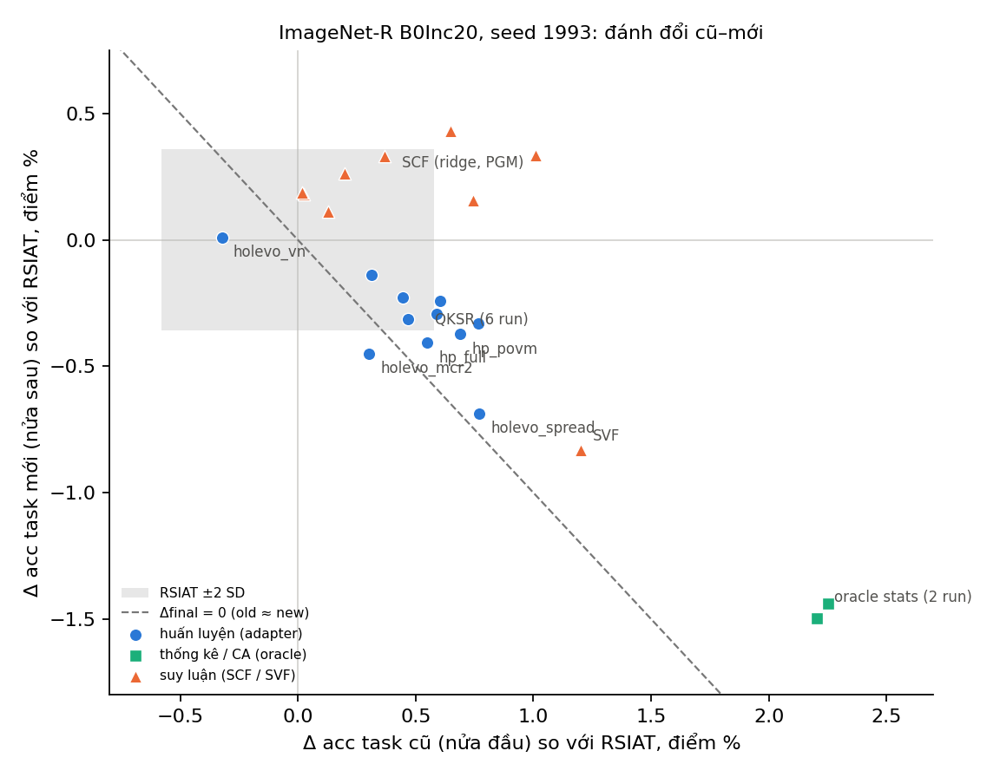

# Q-BOUND phần A: đường đánh đổi cũ–mới (hậu kiểm trên dữ liệu có sẵn)

Đặc tả nằm ở `exps/qbound/README.md` mục 2. Dựng lại bằng:

```bash
python scripts/frontier.py
```

Đầu ra trong `frontier/`:
- `frontier.md`: bảng đầy đủ mọi run và head;
- `frontier.json`;
- `frontier_imagenetr_1993.png`.

Mọi con số được tính lại từ prediction đã lưu (`<log>_stats/*predictions_task_<k>.npz`). Phạm vi gồm 61 run, kèm mọi head lưu trên cùng mạng. Bị loại: `hp_twin` (sụp) và `upper_joint` (không tăng dần).

**Đây là phân tích hậu kiểm trên dữ liệu đã thấy, nên chỉ mang tính khám phá.** Tiêu chí đọc đã ghi trong spec trước khi chạy script.

## Tham chiếu

- RSIAT ImageNet-R seed 1993: 5 mạng khác nhau, gồm 4 run `noise` và `hp_diag`. Các run `qsd2`, `qsd`, `svf` có head `linear` **trùng từng bit** với một trong 5 mạng này nên chỉ đếm một lần.
- Old là trung bình accuracy các task 0–4, new là các task 5–9, đo sau task cuối.

| | Old | New | Final | AIA |
|---|---:|---:|---:|---:|
| Trung bình | 80.76 | 84.45 | 82.56 | 87.33 |
| SD | 0.29 | 0.18 | 0.21 | 0.13 |

## Kết quả theo tiêu chí ghi trước (ImageNet-R 1993)

| Tiêu chí (spec 2.4) | Số liệu | Kết quả |
|---|---|---|
| **Đường đánh đổi giữ:** ≥ 80% can thiệp huấn luyện có \|z old\| > 2 cũng có \|z final\| < 2 | 5/5 run (`holevo_spread`, `hp_povm`, `qksr_cur_rep2`, `qksr_old_rep1`, `qksr_old_rep2`) | **GIỮ** |
| **Suy luận vượt đường:** z final trung bình của nhóm suy luận − nhóm huấn luyện ≥ 1 | +1.43 − (+0.60) = **+0.83** | **KHÔNG ĐẠT** |



## Đọc kết quả

1. **Mọi can thiệp lúc huấn luyện đều đổi task mới lấy task cũ.**
   - Có 0/11 run tăng được cả hai nửa: QKSR 6 run, Holevo 3 run, `hp_full`, `hp_povm`.
   - Tỉ giá trung vị: mất 0.49 điểm task mới cho mỗi điểm task cũ.
   - Vì vậy final nhích nhẹ (trung bình +0.13, z ≈ +0.6) nhưng **AIA đứng yên** (trung bình +0.04, z ≈ +0.3).
   - Final và AIA lệch nhau như vậy vì AIA tính trung bình trên mọi stage. Ở các stage sớm, task cũ chiếm phần lớn, nên phần mất ở task mới bị pha loãng ít hơn.
2. **Oracle stats** (`upper_oracle`, không exemplar-free) dịch xa nhất dọc cùng hướng: old +2.2, new −1.5, final +0.5 (z ≈ 2.5). Ngay cả thống kê hoàn hảo cũng chỉ đổi chỗ giữa task cũ và mới.
3. **SVF** (snapshot task 0, lúc suy luận) nằm trên đúng đường của nhóm huấn luyện: old +1.2, new −0.8.
4. **Chỉ fusion SCF (ridge hoặc PGM) tăng được cả hai nửa.**
   - Trên mọi dataset có lưu head, 28/37 điểm SCF và SVF có Δold > 0 và Δnew > 0. Các điểm không đạt gồm SVF và vài điểm CUB / ImageNet-A.
   - Trên ImageNet-R 1993, SCF cho AIA +0.33 đến +0.60 (z 2–4.5).
   - **Lưu ý:** tách SCF khỏi SVF là quan sát sau khi xem số. Tiêu chí ghi trước gộp SCF với SVF, và nhóm này không qua ngưỡng chênh 1 SD về final.

## Ý nghĩa cho paper

- **Một câu có bằng chứng tốt, được ghi rõ là hậu kiểm:** trên một adapter dùng chung, 11 can thiệp lúc huấn luyện, kể cả 9 can thiệp lượng tử (QKSR, Holevo, POVM), đều nằm trên một đường đánh đổi cũ–mới, với AIA không đổi. Đây là lời giải thích chung cho các kết quả âm của paper.
- **Kết quả dương duy nhất của paper (SCF) khác về chất:** nó tăng cả hai nửa, không chỉ dịch dọc đường đánh đổi. Muốn khẳng định điều này cần kiểm định xác nhận trên run mới. Các run held-out RSIAT của W04 (phần B) có lưu head SCF, nên kiểm định được mà không tốn thêm run.

## Giới hạn

- Hậu kiểm. Các can thiệp chỉ có ở ImageNet-R 1993, ngoại trừ nhóm thống kê/CA ở ImageNet-A 1993. Các dataset khác chỉ có head lúc suy luận.
- Đường "Δfinal = 0" trên hình là xấp xỉ (old ≈ new), vì số ảnh test mỗi task không bằng nhau.
- Với các seed chỉ có một run RSIAT, z dùng SD của seed 1993 cùng dataset. CIFAR và CUB không có replicate nên không có z.
